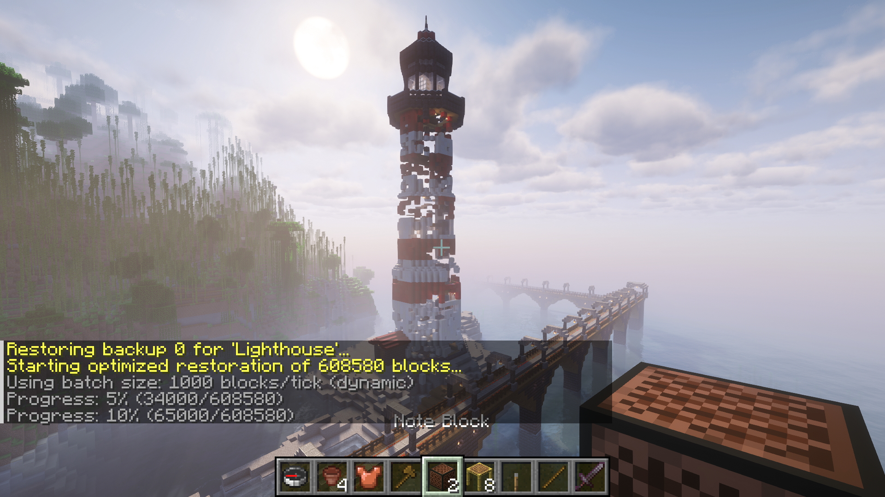
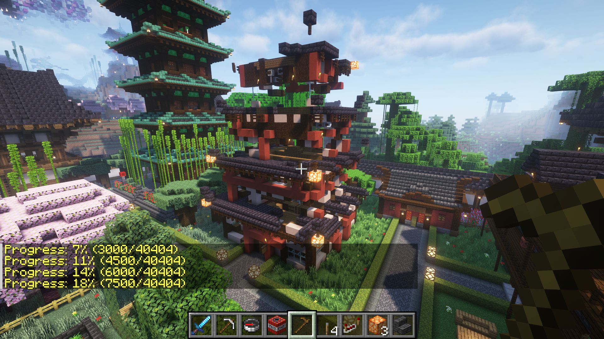

<p align="center">
  
</p>
<h1 align="center">Cobbleworks - Area Rewind Plugin</h1>
<p align="center">
  <b>Protect important builds with named areas and versioned block-state snapshots.</b><br>
  <b>Preview changes, schedule backups, compare versions, and restore damage without rebuilding by hand.</b>
</p>
<p align="center">
  <a href="https://github.com/Cobbleworks/Area-Rewind-Plugin/releases"></a>&nbsp;&nbsp;<a href="https://github.com/Cobbleworks/Area-Rewind-Plugin/blob/main/LICENSE"></a>&nbsp;&nbsp;&nbsp;&nbsp;&nbsp;&nbsp;
</p>

Area Rewind stores named cuboid regions and their block-state snapshots. Owners and trusted players can create backups, preview changes, restore earlier versions, and manage areas through commands or an inventory GUI. Large restores are split across server ticks and can use either automatic or per-area speeds.

## Core Features

- Built-in two-point selection with a wooden hoe or look-target commands
- Optional WorldEdit selection support and `.schem` export
- Manual and scheduled backups with configurable retention
- Restore by backup ID, `latest`, `oldest`, or a relative time
- Undo, redo, current-state scans, and backup-to-backup comparisons
- Owner/trusted-player access model with Bukkit permission nodes
- Particle boundaries and restore previews
- Per-area icons, restore speeds, and automatic backup intervals
- Persistence for areas, backups, inventories, signs, and banner data

## Supported Platforms

- Minecraft 1.21.8 or newer
- Spigot, Paper, Purpur, or a compatible Bukkit server
- Java 21 or newer
- WorldEdit is optional

## Table of Contents

1. [Core Features](#core-features)
2. [Supported Platforms](#supported-platforms)
3. [Installation](#installation)
4. [Third-Party Plugins](#third-party-plugins)
5. [First Area and Backup](#first-area-and-backup)
   - [Access Model](#access-model)
6. [Configuration](#configuration)
7. [Commands](#commands)
   - [Areas and Navigation](#areas-and-navigation)
   - [Backups and Analysis](#backups-and-analysis)
   - [Scheduling and Management](#scheduling-and-management)
   - [Visualization, Export, and Administration](#visualization-export-and-administration)
8. [Permissions](#permissions)
9. [Data and Performance](#data-and-performance)
10. [Building From Source](#building-from-source)
11. [License](#license)
12. [Screenshots](#screenshots)

## Installation

1. Download the latest Area Rewind jar from [Releases](https://github.com/Cobbleworks/Area-Rewind-Plugin/releases).
2. Optionally install [WorldEdit](https://enginehub.org/worldedit) for WorldEdit selections and schematic export.
3. Stop the server and copy the jar into `plugins/`.
4. Start the server to generate the plugin folders and configuration.
5. Run `/rewind`; the management GUI should open.

The current build targets Java 21 and the Spigot 1.21.8 API. The lower value in `plugin.yml` is an API declaration, not a guarantee that the compiled jar runs on older server versions.

## Third-Party Plugins

| Plugin | Required | Purpose |
|--------|----------|---------|
| [WorldEdit](https://github.com/EngineHub/WorldEdit) | No | Reads WorldEdit selections and enables `.schem` exports. |

Without WorldEdit, core selection, backup, restore, comparison, and visualization features remain available.

## First Area and Backup

1. Run `/rewind tool` to receive the selection tool.
2. Left-click one corner and right-click the opposite corner with the wooden hoe. `/rewind pos1` and `/rewind pos2` can instead select the blocks you are looking at.
3. Run `/rewind save spawn_build`.
4. Run `/rewind backup spawn_build` before changing the build.
5. View available snapshots with `/rewind history spawn_build`.
6. Preview a snapshot with `/rewind preview spawn_build <id>`.
7. Restore it with `/rewind restore spawn_build <id>`.

If WorldEdit is installed, `/rewind save <name>` can read the player's current WorldEdit selection. The built-in selection can be forced or toggled per player through the configuration command.

### Access Model

Each area has an owner and may have trusted players. Ownership or trust is checked in addition to feature permissions for sensitive operations such as backups, restores, and visualization. Only an owner or administrator can change trust or area boundaries.

## Configuration

`plugins/AreaRewind/config.yml` contains the server-wide limits:

| Key | Default | Purpose |
|-----|---------|---------|
| `backup.max-backups-per-area` | `50` | Maximum snapshots retained for one area before old entries are pruned. |
| `performance.max-area-size` | `1000000` | Maximum number of blocks allowed in an area. |
| `performance.rate-limit-cooldown` | `1000` | Backup/restore cooldown in milliseconds. |
| `performance.restore.max-batch-size` | `400` | Upper dynamic restore speed in blocks per tick. |
| `performance.restore.min-batch-size` | `100` | Lower dynamic restore speed in blocks per tick. |
| `visualization.particle-distance` | `50` | Maximum particle viewing distance in blocks. |
| `selection.wooden-hoe.force-enabled` | `false` | Always use the built-in wooden hoe selection mode. |
| `selection.wooden-hoe.auto-fallback` | `true` | Fall back to the wooden hoe if WorldEdit is unavailable. |

Players can manage personal behavior with:

```text
/rewind config hoeselection <true|false>
/rewind config progresslogs <true|false>
/rewind config list
```

Administrators can use `/rewind reload` after editing `config.yml`.

## Commands

The root aliases are `/ar`, `/arearewind`, and `/protect`. `/rewind` without arguments opens the GUI.

### Areas and Navigation

| Command | Description |
|---------|-------------|
| `/rewind tool` | Receive the wooden hoe selection tool. |
| `/rewind pos1`, `/rewind pos2` | Set a corner to the block being viewed. |
| `/rewind save <name>` | Create an area from the active selection. |
| `/rewind list [all|owned|trusted]` | List visible areas. |
| `/rewind info <area>` | Show ownership, bounds, trust, and backup information. |
| `/rewind teleport <area>` | Teleport to an area. Alias: `tp`. |
| `/rewind rename <old> <new>` | Rename an area. |
| `/rewind expand <area> <direction> <amount>` | Extend an area boundary. |
| `/rewind contract <area> <direction> <amount>` | Reduce an area boundary. |
| `/rewind delete <area>` | Delete an area and its backups. |

### Backups and Analysis

| Command | Description |
|---------|-------------|
| `/rewind backup <area>` | Create a snapshot immediately. |
| `/rewind history <area> [page]` | List snapshot IDs and timestamps. |
| `/rewind restore <area> <id|latest|oldest>` | Restore a stored snapshot. |
| `/rewind rollback <area> <time>` | Restore the snapshot nearest a relative time such as `30m`, `2h`, or `1d`. |
| `/rewind undo <area>`, `/rewind redo <area>` | Move backward or forward around the most recent restore. |
| `/rewind scan <area>` | Compare the current blocks with the newest backup. |
| `/rewind diff <area> <id|current> <id|current>` | Compare two backups or one backup with the current world. Alias: `compare`. |
| `/rewind preview <area> [id] [particle]` | Highlight blocks that differ from a backup. |
| `/rewind cleanup <area> [days]` | Remove backups older than the requested age. |

### Scheduling and Management

| Command | Description |
|---------|-------------|
| `/rewind interval set <area> <minutes> [backup_id]` | Schedule recurring backups. |
| `/rewind interval check <area>` | Show an area's current schedule. |
| `/rewind interval remove <area>` | Remove the schedule. |
| `/rewind speed <area> <1-10000|dynamic>` | Override or restore the dynamic blocks-per-tick speed. |
| `/rewind trust <area> <player>` | Add a trusted player. |
| `/rewind untrust <area> <player>` | Remove a trusted player. |
| `/rewind permission <add|remove|list> <area> [player]` | Manage stored area access. Aliases: `perm`, `permissions`. |
| `/rewind seticon <area> <material|hand>` | Set the GUI icon for an area. |
| `/rewind seticon backup <area> <id> <material|hand>` | Set a backup's GUI icon. |

### Visualization, Export, and Administration

| Command | Description |
|---------|-------------|
| `/rewind show <area>` | Display an area's particle boundary. |
| `/rewind hide [area]` | Hide one or all displayed boundaries. |
| `/rewind export <area> [backup_id]` | Write a WorldEdit `.schem` file. Requires WorldEdit. |
| `/rewind status` | Show area, backup, and scheduler statistics. |
| `/rewind reload` | Reload the server configuration. Requires administrator access. |
| `/rewind help` | Show the command list available to the player. |

Console and command blocks may use `/rewind cmdrestore <area> <id|latest|oldest> [world]`. Other subcommands are player-only.

## Permissions

| Permission | Default | Purpose |
|------------|---------|---------|
| `arearewind.use` | Everyone | Use the root command and basic information features. |
| `arearewind.create` | Everyone | Create areas. |
| `arearewind.delete` | Everyone | Delete an owned area. |
| `arearewind.backup` | Everyone | Back up an owned or trusted area. |
| `arearewind.restore` | Everyone | Restore an owned or trusted area. |
| `arearewind.trust` | Everyone | Manage trust on an owned area. |
| `arearewind.visualize` | Everyone | Display owned or trusted areas and previews. |
| `arearewind.gui` | Everyone | Use the inventory GUI. |
| `arearewind.export` | Everyone | Export an accessible area through WorldEdit. |
| `arearewind.import` | Everyone | Reserved import permission. |
| `arearewind.admin` | Operators | Bypass area ownership checks and access administration. |
| `arearewind.*` | Operators | Parent node for every Area Rewind permission. |

The defaults above follow `plugin.yml`. Server owners may want to restrict create, restore, export, or delete permissions before opening the server to untrusted players.

## Data and Performance

- Area definitions and backup files are managed under `plugins/AreaRewind/`; stop the server before moving or restoring these files externally.
- Restores are batched across ticks. Start with dynamic speed, monitor tick rate, and lower per-area speed for unusually large or block-entity-heavy builds.
- The maximum area size is measured in blocks, including both selected corners.
- Use the preview or diff command before restoring important builds.
- Scheduled backups obey the per-area retention limit, so they do not grow indefinitely under normal operation.

## Building From Source

Requirements: Java 21 or newer and Maven 3.6 or newer.

```bash
git clone https://github.com/Cobbleworks/Area-Rewind-Plugin.git
cd Area-Rewind-Plugin
mvn clean package
```

The compiled jar is written to `target/`.

## License

This project is licensed under the [MIT License](LICENSE).

## Screenshots

<table>
  <tr>
    <th>Lighthouse Restore</th>
    <th>Mansion Backup Diff</th>
  </tr>
  <tr>
    <td><a href="images/screenshot-lighthouse-restore.png"></a></td>
    <td><a href="images/screenshot-mansion-diff.png"></a></td>
  </tr>
  <tr>
    <th>Factory Schematic Export</th>
    <th>Asian Temple</th>
  </tr>
  <tr>
    <td><a href="images/screenshot-factory-export.png"></a></td>
    <td><a href="images/screenshot-asian-temple.png"></a></td>
  </tr>
  <tr>
    <th>Bridge Restore</th>
    <th>Pirate Ship</th>
  </tr>
  <tr>
    <td><a href="images/screenshot-bridge-restore.png"></a></td>
    <td><a href="images/screenshot-pirate-ship.png"></a></td>
  </tr>
</table>
